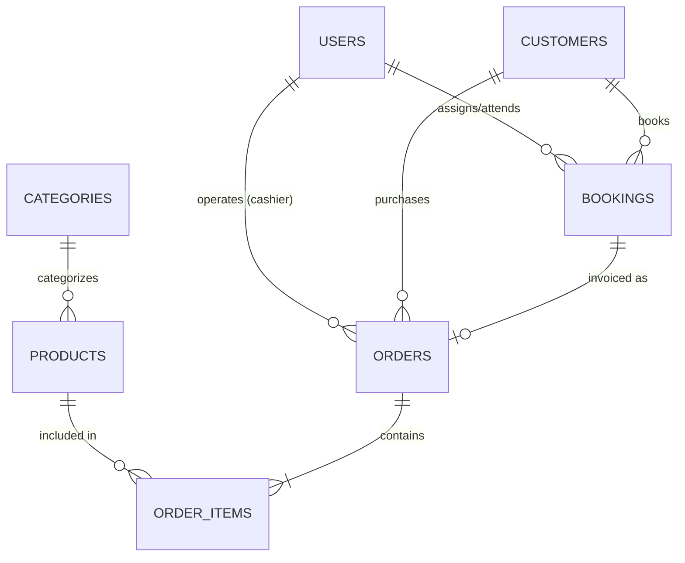

# ⚡ Modern POS & Booking System Starter Kit (Laravel & Filament)

<p align="center">
  
</p>

<p align="center">
  <a href="https://laravel.com"></a>
  <a href="https://filamentphp.com"></a>
  <a href="https://php.net"></a>
  <a href="https://mysql.com"></a>
  <a href="LICENSE"></a>
  
</p>

<p align="center">
  Starter kit *open-source* siap pakai yang menggabungkan <strong>Sistem Kasir (Point of Sale / POS)</strong> interaktif dengan <strong>Manajemen Reservasi & Jadwal Booking Layanan</strong> dalam satu panel modern berbasis <strong>Laravel & Filament</strong>. Cocok untuk Cafe, Retail Shop, Barbershop, Salon & Spa, Studio Foto, hingga Klinik Kesehatan.
</p>

---

## 🌟 Fitur Unggulan (Key Features)

### 🛒 1. Point of Sale (POS) Interaktif
- **Katalog Visual & Pencarian Cepat:** Filter produk berdasarkan kategori dan pencarian instan (nama, SKU, barcode).
- **Keranjang Belanja Real-Time:** Penambahan produk dengan 1 klik, pengatur kuantitas (+/-), validasi stok fisik otomatis.
- **Kalkulasi Finansial Otomatis:** Perhitungan subtotal, input diskon (Rp), dan pilihan opsi pajak (PPN 11% / Bebas Pajak).
- **Integrasi Booking-to-POS:** Impor data reservasi pelanggan ke mesin kasir dengan 1 klik untuk langsung diproses pembayarannya.

### 📱 2. Mockup Pembayaran Modern
- **Tunai (Cash):** Tombol cepat nominal pecahan uang (Uang Pas, 50k, 100k, 200k) dan kalkulasi otomatis kembalian pelanggan.
- **QRIS Dinamis:** Mockup QR code QRIS interaktif untuk simulasi pembayaran e-wallet (GoPay, OVO, Dana, ShopeePay) & mobile banking.
- **Transfer Bank & Kartu Debit:** Pencatatan metode pembayaran non-tunai.

### 🧾 3. Cetak Struk Kasir (Thermal Receipt)
- Format struk belanja bergaya kertas *thermal printer* (80mm/58mm friendly).
- Menampilkan nomor invoice faktur, rincian item, subtotal, diskon, PPN, metode bayar, dan nominal kembalian.
- Tombol **Cetak Struk** langsung memicu dialog cetak printer bawaan browser (`window.print()`).

### 🗓️ 4. Jadwal Booking & Reservasi Layanan
- Manajemen janji temu dengan tanggal, waktu mulai, dan estimasi waktu selesai.
- Penugasan staf PIC / Terapis / Kapster penanggung jawab.
- Status alur reservasi lengkap: `Pending` ➔ `Confirmed` ➔ `In Progress` ➔ `Completed` ➔ `Cancelled`.
- Tombol aksi cepat *"Tandai Selesai"* langsung dari daftar tabel.

### 📊 5. Dashboard Eksekutif & Statistik
- Ringkasan omset penjualan harian secara *real-time*.
- Metrik jumlah reservasi aktif hari ini.
- Notifikasi peringatan stok barang yang menipis (<=10 item).
- Tabel transaksi POS terbaru pada halaman utama admin.

### 🔐 6. Role-Based Access Control (RBAC)
- Ditenagai oleh `spatie/laravel-permission`.
- Role bawaan: **Admin** (Akses penuh) dan **Kasir** (Fokus operasional kasir & transaksi).

---

## 📸 Antarmuka Sistem (Screenshots Preview)

| Halaman | Deskripsi |
| :--- | :--- |
| **🖥️ Mesin Kasir POS** | Layout dua kolom responsif dengan grid produk, kontrol keranjang belanja, dan modal pembayaran. |
| **🗓️ Jadwal Booking** | Filter status, pencarian pelanggan, dan konfirmasi reservasi cepat. |
| **📦 Manajemen Produk** | Dukungan produk fisik (*goods*) dan produk layanan (*service*). |
| **🧾 Struk Kasir** | Desain thermal paper bersih dan siap print. |

---

## 🚀 Panduan Instalasi (Getting Started)

Pastikan lingkungan Anda memenuhi persyaratan berikut:
- **PHP** >= 8.2 (dengan ekstensi `pdo_mysql`, `curl`, `mbstring`, `intl`)
- **Composer** >= 2.0
- **MySQL** >= 8.0 atau MariaDB

### Langkah 1: Clone Repositori
```bash
git clone https://github.com/USERNAME_ANDA/pos-booking-starter.git
cd pos-booking-starter
```

### Langkah 2: Install Dependensi Composer
```bash
composer install
```

### Langkah 3: Konfigurasi File Lingkungan (.env)
Salin file `.env.example` menjadi `.env`:
```bash
cp .env.example .env
```
Sesuaikan pengaturan koneksi database MySQL Anda di `.env`:
```env
DB_CONNECTION=mysql
DB_HOST=127.0.0.1
DB_PORT=3306
DB_DATABASE=pos_booking
DB_USERNAME=root
DB_PASSWORD=
```

### Langkah 4: Generate Application Key
```bash
php artisan key:generate
```

### Langkah 5: Migrasi Database & Seeding Data Awal
Jalankan migrasi tabel beserta *dummy seeder* (kategori, produk retail, produk jasa, pelanggan, pesanan contoh):
```bash
php artisan migrate --seed
```

### Langkah 6: Buat Symlink Storage
```bash
php artisan storage:link
```

### Langkah 7: Jalankan Server Lokal
```bash
php artisan serve
```
Buka peramban (*browser*) Anda dan akses:
👉 **[http://localhost:8000](http://localhost:8000)** (akan otomatis diarahkan ke Panel Admin `/admin`).

---

## 🔑 Akun Default (Demo Credentials)

Gunakan akun berikut untuk masuk ke dashboard admin:

| Peran (Role) | Email | Password | Akses Utama |
| :--- | :--- | :--- | :--- |
| **Administrator** | `admin@example.com` | `password` | Akses penuh (Dashboard, Master Data, Transaksi, User) |
| **Kasir** | `kasir@example.com` | `password` | Operasional Kasir (POS) & Riwayat Transaksi |

---

## 🏗️ Struktur Basis Data (Database Architecture)



---

## 🧪 Menjalankan Pengujian (Automated Testing)

Starter kit ini dilengkapi dengan unit & feature testing:
```bash
php artisan test
```

---

## 🤝 Berkontribusi (Contributing)

Kontribusi untuk perbaikan *bug*, penambahan fitur (misal: integrasi payment gateway Midtrans/Xendit nyata, export Excel/PDF laporan), atau peningkatan performa sangat diterima!

1. *Fork* repositori ini
2. Buat branch fitur baru (`git checkout -b feature/FiturKeren`)
3. *Commit* perubahan Anda (`git commit -m 'feat: Menambahkan fitur X'`)
4. *Push* ke branch (`git push origin feature/FiturKeren`)
5. Ajukan *Pull Request*

---

## 📄 Lisensi (License)

Proyek ini dilisensikan di bawah [Lisensi MIT](LICENSE). Bebas digunakan, dimodifikasi, dan didistribusikan untuk keperluan komersial maupun personal.

---

<p align="center">
  Dibuat dengan ❤️ untuk komunitas open-source developer Indonesia. Jangan lupa beri <strong>⭐ Star</strong> jika repositori ini bermanfaat bagi Anda!
</p>
