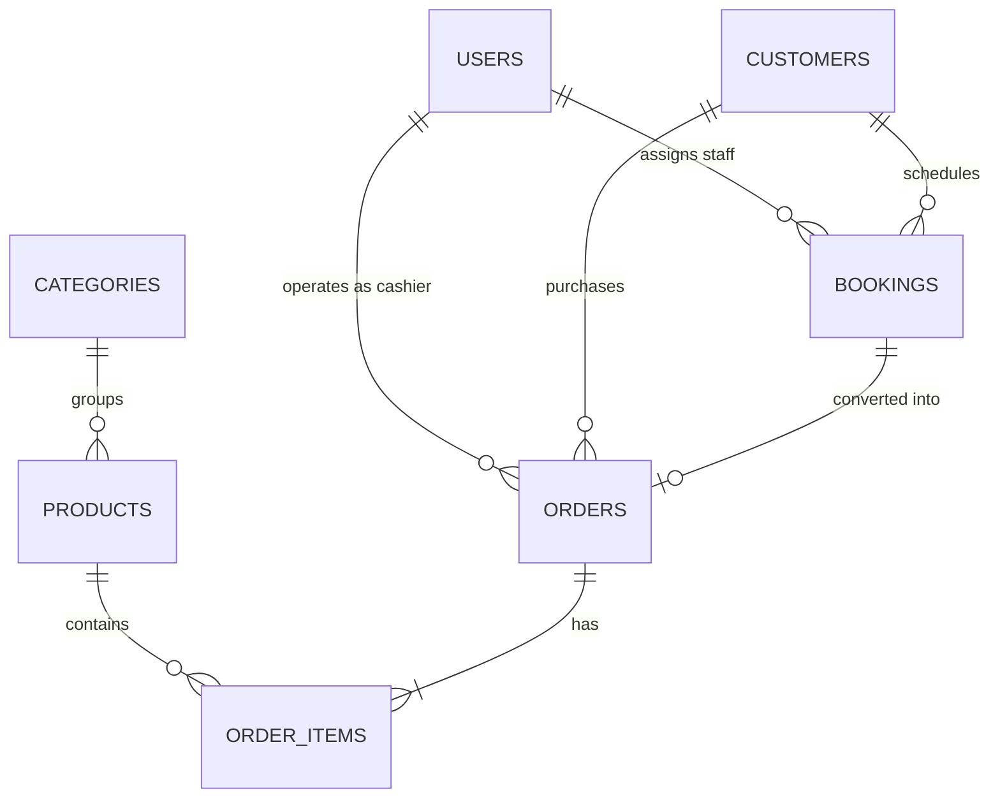

<p align="center">
  <a href="https://github.com/Damar2121/laravel-pos-booking">
    
  </a>
</p>

<h1 align="center">⚡ NexPOS: Modern Point of Sale & Appointment Booking Starter Kit</h1>

<p align="center">
  <strong>An open-source, production-ready Point of Sale (POS) & Service Appointment Booking platform built with Laravel 12 & Filament.</strong>
  <br />
  <em>Perfect for Cafes, Retail Stores, Barbershops, Salons, Wellness Spas, Photography Studios, and Healthcare Clinics.</em>
</p>

<p align="center">
  <a href="https://github.com/Damar2121/laravel-pos-booking/stargazers"></a>
  <a href="https://github.com/Damar2121/laravel-pos-booking/network/members"></a>
  <a href="https://laravel.com"></a>
  <a href="https://filamentphp.com"></a>
  <a href="https://php.net"></a>
  <a href="https://mysql.com"></a>
  <a href="LICENSE"></a>
</p>

---

## 💡 Why NexPOS?

Most existing open-source solutions force you to choose: either a **retail POS** with inventory or a **booking system** for appointments. 

**NexPOS unites both in one cohesive platform.** 
A customer can walk in for a haircut or massage appointment, grab a coffee or styling pomade at checkout, and have everything billed seamlessly onto one unified receipt.

```
┌────────────────────────────────────────────────────────────────────────┐
│                        ⚡ NexPOS ARCHITECTURE                          │
│                                                                        │
│   🛒 RETAIL & GOODS POS         ➕        🗓️ SERVICE & APPOINTMENTS    │
│   • Barcode / SKU Scanning              • Staff / Specialist PIC       │
│   • Real-time Inventory Deduction       • Timeslots & Schedules        │
│   • Category Grid & Instant Search      • 1-Click Import to Register   │
│                                                                        │
│                                    ▼                                   │
│                        💳 UNIFIED CHECKOUT ENGINE                      │
│                [Cash / Change] • [Dynamic QRIS] • [EDC/Cards]          │
│                                    ▼                                   │
│                       🧾 THERMAL RECEIPT PRINTING                      │
└────────────────────────────────────────────────────────────────────────┘
```

---

## ✨ Key Features

### 🛒 1. Interactive Point of Sale (POS) Cashier Interface
- **Lightning-Fast Livewire UI:** Add items to cart with a single click, adjust quantities (`+` / `-`), or remove them with real-time reactive calculations.
- **Instant Search & Category Pills:** Quickly locate products by Name, SKU, or Barcode scan.
- **Inventory Safety Checks:** Prevents overselling by automatically validating warehouse physical stock.
- **Discount & Tax Support:** Apply instant cash discounts and flexible sales tax (PPN 11% / Tax-free).
- **Booking Integration:** 1-click button to load active appointments into the checkout register.

### 🗓️ 2. Appointment & Reservation Management
- **Complete Booking Workflow:** Track statuses from `Pending` ➔ `Confirmed` ➔ `In Progress` ➔ `Completed` ➔ `Cancelled`.
- **Specialist & Staff Assignment:** Assign specific baristas, therapists, barbers, or staff members to bookings.
- **Quick Actions:** Mark bookings completed directly from the table view.

### 💳 3. Omnichannel Payment Mockups
- **Cash Payments:** Real-time change calculation with quick-denomination buttons (*Exact Amount, 50k, 100k, 200k*).
- **Instant QRIS Simulation:** High-contrast QR code display that simulates e-wallet & mobile banking settlement.
- **Bank Transfer & Card:** Support for logging card and electronic payments.

### 🧾 4. Print-Ready Thermal Receipt Generator
- Designed to replicate standard 58mm / 80mm thermal receipt slips.
- Displays store details, transaction timestamp, cashier name, customer name, line item subtotals, tax/discounts, and change returned.
- Built-in **Print Receipt** trigger (`window.print()`).

### 📊 5. Executive Dashboard & Real-Time Analytics
- **Today's Revenue:** Live gross turnover tracking from settled transactions.
- **Active Appointments:** Instant headcount of scheduled reservations for the day.
- **Low-Stock Sentinel:** Automatic warning for products with $\le 10$ items in stock.
- **Latest Orders Feed:** Live summary table of recent sales transactions.

### 🔐 6. Role-Based Access Control (RBAC)
- Powered by `spatie/laravel-permission`.
- Pre-configured with **Admin** (Full system access) and **Cashier** (POS operations & order history).

---

## 📸 Screenshots & UI Preview

| View | Feature Details |
| :--- | :--- |
| **🖥️ POS Cashier Terminal** | Split-screen reactive catalog, dynamic cart stepper, customer selector, and checkout modal. |
| **🗓️ Appointment Calendar** | Comprehensive schedule tracker with staff assignments and status badges. |
| **📊 Executive Dashboard** | Key performance indicators (revenue, low-stock alerts, active reservations). |
| **🧾 Thermal Receipt** | Clean printer slip preview formatted for customer checkout. |

---

## 🚀 Quick Start Guide (Installation in 2 Minutes)

### Prerequisites
- **PHP** $\ge$ 8.2 (with `pdo_mysql`, `curl`, `mbstring`, `intl`)
- **Composer** $\ge$ 2.0
- **MySQL** $\ge$ 8.0 or MariaDB

### 1. Clone the Repository
```bash
git clone https://github.com/Damar2121/laravel-pos-booking.git
cd laravel-pos-booking
```

### 2. Install Composer Dependencies
```bash
composer install
```

### 3. Setup Environment File
Copy `.env.example` to `.env`:
```bash
cp .env.example .env
```
Ensure your MySQL credentials are configured in `.env`:
```env
DB_CONNECTION=mysql
DB_HOST=127.0.0.1
DB_PORT=3306
DB_DATABASE=pos_booking
DB_USERNAME=root
DB_PASSWORD=
```

### 4. Generate Application Key
```bash
php artisan key:generate
```

### 5. Migrate Database & Seed Sample Data
Populate categories, retail items, services, demo customers, appointments, and transactions:
```bash
php artisan migrate --seed
```

### 6. Symlink Storage & Launch Local Server
```bash
php artisan storage:link
php artisan serve
```

Visit **[http://localhost:8000](http://localhost:8000)** in your browser! It will automatically redirect to the admin panel (`/admin`).

---

## 🔑 Demo Credentials

| Role | Email | Password | Primary Capabilities |
| :--- | :--- | :--- | :--- |
| **Administrator** | `admin@example.com` | `password` | Full master data, staff, orders, reports & users |
| **Cashier (Kasir)** | `kasir@example.com` | `password` | POS register, daily sales, and appointment check-in |

---

## 🏗️ Database Relationship (ERD)



---

## 🧪 Automated Test Suite

NexPOS is thoroughly tested with Laravel's feature testing suite:
```bash
php artisan test
```

All 4 test suites pass with 100% assertions covering routing, redirects, permissions, and booking-to-order creation.

---

## 🗺️ Roadmap & Upcoming Features

- [ ] **Real Payment Gateway Integration:** Midtrans, Stripe, and Xendit webhooks.
- [ ] **WhatsApp Notification Engine:** Automatic appointment reminders sent to customers via WhatsApp API.
- [ ] **Kitchen & Bar Display System (KDS):** Real-time order screen for kitchen preparation.
- [ ] **Export to PDF & Excel:** Export financial reports and tax summaries.
- [ ] **Multi-Outlet / Multi-Branch:** Franchise & tenant support.

---

## 🤝 Contributing

Contributions make the open-source community an amazing place to learn, inspire, and create! Any contributions you make are **greatly appreciated**.

1. **Fork** the Project
2. Create your Feature Branch (`git checkout -b feature/AmazingFeature`)
3. Commit your Changes (`git commit -m 'feat: Add some AmazingFeature'`)
4. Push to the Branch (`git push origin feature/AmazingFeature`)
5. Open a **Pull Request**

---

## 📄 License

Distributed under the **MIT License**. See [`LICENSE`](LICENSE) for more information.

---

<p align="center">
  Built with ❤️ for modern businesses and the global open-source community.<br />
  If this project saved you development time, please consider giving it a <strong>⭐ Star</strong>!
</p>
